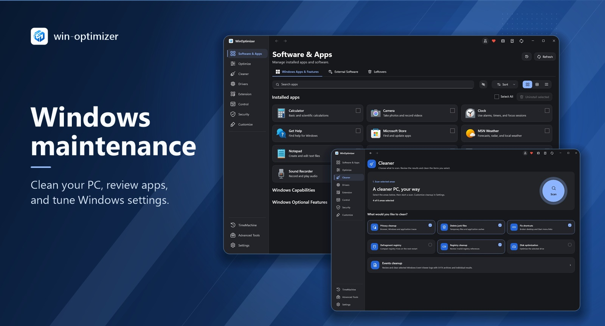

# win-optimizer for Windows 10 and 11

win-optimizer is an open-source tool for Windows cleanup, optimization, and
maintenance. Use it to free disk space, remove unwanted apps, change privacy
and performance settings, and check Windows health.

Review scan results before you remove files, apps, or drivers. Use **Test mode**
to prepare supported changes in a draft. Use **TimeMachine** to browse saved
snapshots, compare settings, and restore supported changes if necessary.
Use the task icon in the title bar to check shared operation progress and output.

## Download win-optimizer

**[Download the latest Windows x64 installer](https://github.com/sh1zen/win-optimizer/releases/latest)**

### System requirements

Use a Windows 10 or Windows 11 PC that can run x64 apps. The main app requires
administrator permissions. Some hardware tools require compatible firmware or
drivers. The installer includes the .NET and Windows App SDK runtimes.

### Install and open the app

1. Open `win-optimizer.Installer.exe`.
2. Select **Regular** or **Portable**.
3. Select the destination folder.
4. Open `win-optimizer.exe` to see the Dashboard with hardware details, live CPU and memory usage, system drive capacity, and quick actions. Search from the title bar to see results over the current page.

**Regular** adds Windows shortcuts and an uninstall entry. **Portable**
installs the app in a folder you can move.

Turn on **Start win-optimizer as administrator** under **Settings → General →
Info** to launch at sign-in. Select **Current Version** in the same section to
check for updates. Manual checks show the result in a toast. The app verifies
the installer against the SHA-256 digest published with its GitHub release
before offering to restart.

[Installation, first launch, app settings, automatic startup, updates, and uninstallation](docs/GETTING-STARTED.md)

Open **Dashboard → Bench** to view hardware details and run CPU, GPU, memory,
and disk benchmarks. [Run a benchmark](docs/GETTING-STARTED.md#measure-pc-performance)

## Clean and configure Windows

### Disk and registry cleanup

Use **Cleaner** to find temporary files, browser traces, broken shortcuts, and
registry entries. Follow scan progress by area, then select the items to remove.
The cleanup report shows removed items, errors, and estimated disk space freed.
Select a category card to see its results.
Cleaner can also optimize disks and defragment the registry.

[Run a cleanup and read the report](docs/CLEANER.md)

### Windows app and desktop program removal

Use **Software & Apps** to uninstall built-in Windows apps, optional features,
and desktop programs. Scan for files and registry entries after an uninstall.
The **Leftovers** tab also checks old installer caches and folders. The app
verifies a backup before it deletes selected leftovers.

[Uninstall apps and review leftovers](docs/SOFTWARE-APPS.md)

### Windows privacy, performance, and desktop settings

Use **Optimize** to change privacy, gaming, power, Windows Update, and network
settings. Use **Customize** to change themes, the taskbar, the Start menu, and
File Explorer context menus.

[Find and change Windows settings](docs/WINDOWS-SETTINGS.md)

### Internet speed and network settings

Use **Internet** in the sidebar to measure download, upload, and HTTPS latency
to Cloudflare. Compare with the previous result, configure DNS in the
**Network** card, and manage Windows VPN profiles. In **Network settings**, edit
TCP auto-tuning and RSS individually, limit background download bandwidth on
supported Windows editions, and compare saved original values with suggested values.

[Measure and tune the connection](docs/WINDOWS-SETTINGS.md#internet)

### Windows security checks

Use **Security** to check antivirus registration, firewall profiles, and User
Account Control. The scan checks the local Windows Update cache for pending
security updates. Follow its coverage and progress while it runs.
A deep scan also checks network protocols and Firefox home
page protection. Browse findings by category, review technical details, and
apply supported fixes.

[Run a security scan and review fixes](docs/SECURITY.md)

## Maintain and monitor the PC

### Disks, file recovery, and USB

Open **Disks** in the sidebar and select a tool to unlock and delete a file,
reset inherited permissions, restore previous versions from shadow copies,
or verify a file or folder with SHA-256. You can also safely eject USB storage,
scan for deleted files, and analyze or optimize a fixed drive.

[Use the disk tools and recover files](docs/DISKS.md)

### Driver updates and unused packages

Use **Drivers** to compare installed drivers with updates from official sources.
Review compatible updates with verified INF matches and check source coverage
and certification. When an NVIDIA package is eligible for verification, review
its license during the scan. Use **Cancel scan** to stop an active scan.
When a cancelled scan stops, the app returns to the starting page and shows a notification.
Download matching packages, search disconnected
devices, and review entries before removal.

[Check driver updates and remove unused packages](docs/DRIVERS.md)

### Startup, processes, and Windows repair

Use **Control → Autorun management** to filter startup entries and inspect or
change their state. Use **Control** to inspect running processes, check network
connections, and edit environment variables or the hosts file. Set battery
charge limits and restart thresholds on compatible hardware, and check whether
charging continues above the limit. Use **Repair** in the sidebar to check
Windows health and run DISM and SFC repairs.
Turn on **Quick status** beside **Diagnose** for a quick health check.
Follow progress in Repair, then read the outcome and next steps in the report.
A full diagnosis can identify affected components in the report.
Return to the overview to run **Diagnose** again or reopen the latest report.
Select the **Info** icon in Repair for requirements, log locations, and guidance.

[Manage startup, monitor processes, and repair Windows](docs/SYSTEM-TOOLS.md)

### Hardware monitoring and desktop widgets

Open **Extension** in the sidebar. Use **SysMonitor** to see CPU, memory,
network, and available hardware sensor readings on the desktop. Use **Notch**
for media controls, a focus timer, a calendar, and quick access to apps and files.
Enabled widgets run in a desktop companion while the main app closes independently.

[Set up SysMonitor and Notch](docs/EXTENSIONS.md)

## Preview files, prepare installations, and recover settings

### File Explorer preview with Space

Turn on **Preview** to use **Space** on the desktop or in File Explorer. Preview
can show folder details, text, images, PDF pages, and media.

[Turn on Preview and see supported formats](docs/PREVIEW.md)

### Windows installation media and unattended setup

Use **WIMUtil** to add drivers and an answer file to Windows installation media.
Use **Create Autounattend XML** to generate an answer file for unattended setup.
**Advanced Tools** also shows hardware and Windows information.
In **Experimental Features**, select **Technical Details** on a feature card to
review its configuration and recovery actions.

[Customize installation media and generate an answer file](docs/ADVANCED-TOOLS.md)

### Test mode, configuration files, and TimeMachine

Use **Test mode** to prepare changes. Select whether to apply, export, or discard
them. Import saved settings from a configuration file. Use **TimeMachine** to
create, review, and delete snapshots or restore supported changes from the
timeline. Use **Restore** to manage Windows restore points.

[Use Test mode, export settings, and restore changes](docs/CONFIGURATION-RECOVERY.md)

## Development

- [Build, package, and release win-optimizer](docs/DEVELOPMENT.md)
- [Run tests](tests/README.md)
- [Read the architecture](ARCHITECTURE.md)
- [Read the changelog](CHANGELOG.md)

## Support

[Report a problem or request a feature](https://github.com/sh1zen/win-optimizer/issues).
To support development, select the heart icon in the title bar. You can also open
**Settings → General → Support win-optimizer** or [donate through PayPal](https://www.paypal.com/donate/?hosted_button_id=8G8VR4APG9JRU).

Microsoft Corporation owns the Windows trademark. win-optimizer is an independent
project.

## License

win-optimizer uses the [Apache License, Version 2.0 (Apache-2.0)](LICENSE).
Copyright © Andrea Frolli. The application folder contains the license and the
[third-party notices](THIRD-PARTY-NOTICES.txt).
