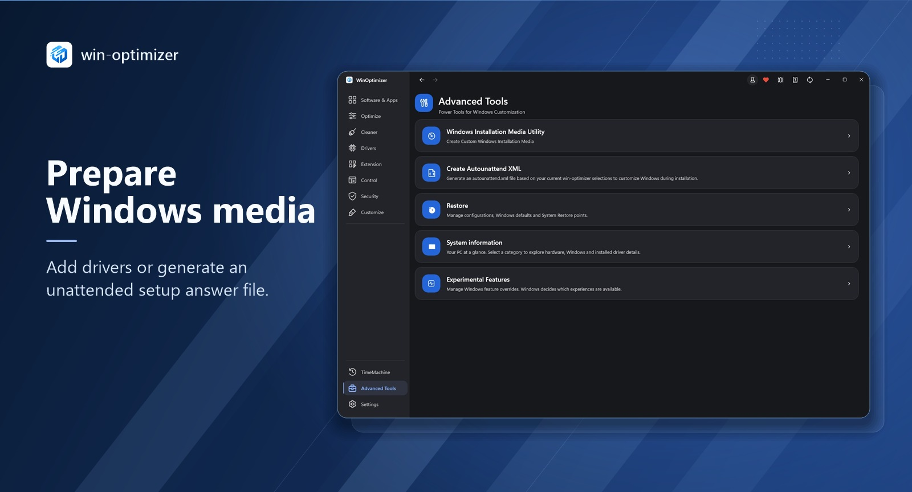

# Prepare Windows installation media and manage advanced features



## Customize installation media with WIMUtil

Use **Advanced Tools → WIMUtil** to customize a Windows installation image,
add drivers, and generate or select a Windows answer file. Extracted media
must contain Windows Setup, the boot image, and a WIM or ESD installation
image. Keep the source ISO outside the extraction folder.

Image conversion exports and verifies each edition before it replaces the
source image. Driver integration keeps nested package files and existing
setup commands.

The app resets dependent steps if you change or extract the media again.
If extraction fails, the dependent steps stay locked. Build the ISO again
after a change to the answer file, drivers, or image files.

ISO creation waits for active operations. It builds and verifies a temporary
ISO before it replaces the destination file. A failure or cancellation leaves
an existing ISO in place.

## Generate a Windows answer file

Select **Create Autounattend XML**. Select settings for unattended Windows
installation. Generate the XML answer file from those settings.

## View system information

Open **System information** to collect a dated snapshot of the hardware,
Windows installation, and installed drivers. The page uses the last snapshot
until you select **Refresh**. It identifies unavailable data. Cancellation
keeps the previous snapshot.

Driver signature metadata describes the installed drivers. Use the
[Drivers page](DRIVERS.md#check-for-driver-updates) for WHQL verification of
update candidates.

## Manage experimental Windows features

Open **Advanced Tools → Experimental Features**. Use the toolbar on the
right to search, refresh, or import compatibility profiles. The catalog shows
the installed Windows build, revision, and one card per feature.

The built-in profiles cover Windows Search, the modern Run dialog, and the
pointer indicator on x64 build 26200.10066, 26200.10075, 26300.10066, and
26300.10075 (KB5132057). The catalog also describes the Desktop Window
Manager (DWM) pointer flag on x64 build 26220.9606. Windows Search requires
English as the Windows display language. Select **Technical Details** to open
a scrollable popup with compatibility evidence, sources, and a card for each
applicable feature ID. Each ID card lists its action targets and observed
configurations.

### Apply or restore a feature setting

Use an administrator account and Normal mode to make changes.

- Select **Enable** or **Disable** to set User-priority overrides.
- Open **Technical Details** to select **Restore Windows default**. This
  action removes the User-priority overrides for that feature.
- In the same popup, select **Undo last change** to restore the saved runtime
  and persistent values. Undo also restores variants and entries that were absent.

After a partial failure or cancellation, use **Undo last change** on the
affected feature. A Windows update or external change can block recovery.
The page shows the reason.

The page shows the configured override, observed runtime configuration,
and restart status separately. Restart Windows. Then refresh the page
to check the startup snapshot. Windows controls feature availability and
can require a separate setting.

### Import compatibility profiles

For other Windows client releases with build 19041 or later, select
**Import compatibility profiles**. Select a JSON file with mappings that
you verified for the target build, revision, and architecture.

Import replaces only the local profile set.
The app uses built-in profiles before imported profiles. **Technical Details**
identifies imported profiles. Windows reports numeric flags. Verify what a
flag controls for each release before you use the same number again.

The example maps the modern Run dialog on x64 build 28120.3542. Specify the
enable state for each component. Set `disable` to `null` to keep a dependency
when you disable the feature.

Use `options`, `variant`, `payloadKind`, and `payload` when the sources
document them for that build. A profile can also use
`"prerequisites": ["englishWindows"]` or `"prerequisites": []` if the
sources confirm the release requirements.

```json
{
  "schemaVersion": 1,
  "profiles": [
    {
      "featureKey": "Run",
      "target": { "build": 28120, "revision": 3542, "architectures": ["x64"] },
      "requirements": [
        { "id": 58381341, "enable": { "state": "enabled" }, "disable": null, "dependency": true },
        { "id": 57156807, "enable": { "state": "enabled" }, "disable": { "state": "disabled" } },
        { "id": 57259990, "enable": { "state": "enabled" }, "disable": { "state": "disabled" } },
        { "id": 58989092, "enable": { "state": "enabled" }, "disable": { "state": "disabled" } }
      ],
      "sources": [
        "https://learn.microsoft.com/en-us/windows-insider/release-notes/experimental-26-h1/preview-build-28120-3542",
        "https://betawiki.net/wiki/Windows_11_build_28120.3542"
      ]
    }
  ]
}
```

Use the feature key `Search`, `Run`, or `Pointer`. Use `x64` or `arm64`
only when the source evidence covers that architecture. Include each local
mapping that you want to keep. Use an empty `profiles` array to clear the
local set.

The app keeps unfinished recovery records for the original Windows release.
You can continue recovery if Windows returns to that release.

For other recovery tools, see
[configuration files and Windows restore points](CONFIGURATION-RECOVERY.md).
