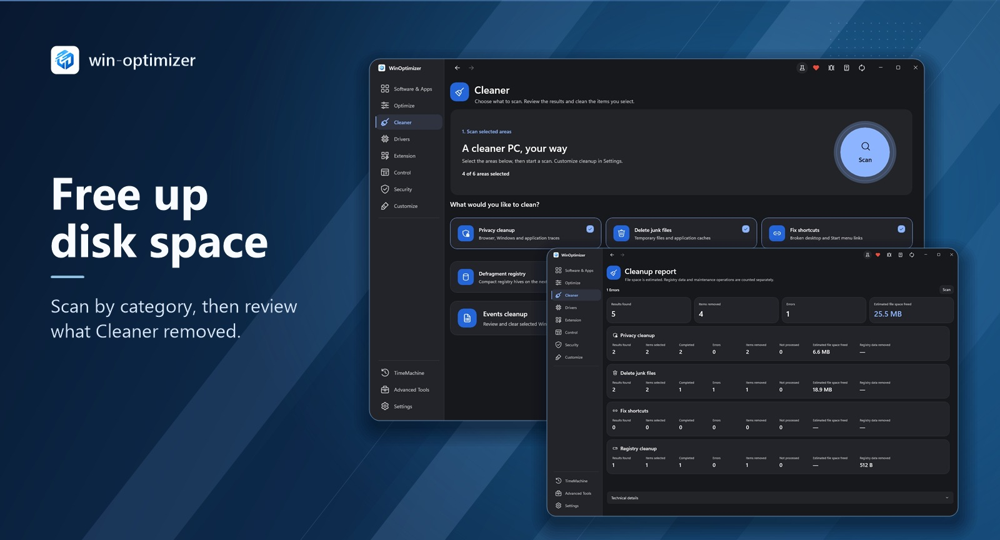

# Clean junk files and maintain disks and the registry

## Scan and clean

1. Open **Cleaner**.
2. Select the scan options.
3. Select **Scan**. The progress card highlights the active scan area. Use
   **View details** for live output or **Cancel scan** to stop.
4. Select a category on the left.
5. Select the items to clean on the right.
6. Select **Clean selected items**.
7. Confirm the operation.

Use **Select all results** or **Clear selection** to change selections across
the scan. Each category shows the numbers of items found, selected, and
protected. Changing the category keeps the selections and expanded groups.

Cleaner saves the scan options. Scan again after you change the options or
before you start a second cleanup. Failed or canceled scans supply no cleanup
plan.

Use **Settings → Cleaner** to change the scan targets, file age, registry
categories, deep scan, cache locations, or drive. Privacy, junk, registry,
and shortcut scans each have an account selection. Cleaner selects the
signed-in account by default. Clear all accounts to scan only the enabled
common locations. Cleaner reports unavailable profiles.

## Scan coverage and protections

| Scan | Coverage and limits |
| --- | --- |
| Junk files | Default locations include user and Windows temporary folders, diagnostic logs, WER reports, crash dumps, temporary Internet files, thumbnails, and DirectX shader caches. Diagnostic logs include CBS archives and DISM, Setup, and Windows Update logs. Cleaner uses your saved exclusions. You can add installed-app LocalCache and TempState folders. These rules exclude Windows Installer, the component store, and Prefetch. |
| Privacy traces | Cleaner checks known browser cache and history locations and Windows and app traces. You can add Office and WinRAR history, jump lists, offline browser caches, and Defender support logs. Removal of jump lists also removes pinned items. The scan can miss portable apps and custom paths. |
| Broken shortcuts | Cleaner checks selected desktop, Start menu, and recent-document locations for confirmed missing local targets. It keeps shortcuts with unresolved or unavailable network targets. The recent-document scan is on by default and has a separate switch from the privacy-history scan. Cleaner reports a result only once if two scans find it. |
| Registry cleanup | Cleaner checks typed references in the applicable registry views. Select each registry value that you want to remove. Service, virtual-device, and firewall findings are diagnostic. Cleaner checks references and file evidence again before cleanup. |
| Registry defragmentation | Cleaner uses the selected registry accounts. A deep scan also checks device-wide hives. See the [maintenance boot procedure](#defragment-the-registry). |
| Disk optimization | Disk analysis shows the target drive and the full Windows report. You can select the report text. |

Cleaner lists recent junk files and protects them by default if their
modification age is less than seven days. You can set the limit from 0 to
365 days. Set it to 0 to include recent inactive files.

Cleaner protects locked files and files that an app uses after the scan starts.
The results show the reason and prevent selection. Close the app that uses
the file. Then scan again.

## Read results and restore a backup

The cleanup report summarizes the results and shows a card for every category
selected for the scan, including categories with no results. Select a card
to see how many items were found, selected, completed, removed, failed, or
left unprocessed. Partial or canceled cleanup keeps completed results.

**Selected data size** includes file lengths and estimated registry-value data.
The estimate excludes registry metadata and measures selected data only.
Cleaner estimates disk space freed from files that it removed. Category
details show file space and removed registry data where applicable. The
report counts maintenance as completed operations and shows sizes in B, KB,
MB, or GB.

Open **View details** while reviewing the scan to see any scan notices. Use
the cleanup task's details for diagnostic output.

Cleaner enables file and registry-value backups by default. Use **Settings**
to restore a backup. The restore keeps current data if there is a conflict.
See also [TimeMachine recovery](CONFIGURATION-RECOVERY.md#driver-package-and-cleanup-recovery).

## Defragment the registry

Install the [Windows ADK Deployment Tools and matching Windows PE add-on](https://learn.microsoft.com/windows-hardware/get-started/adk-install)
in their default locations. Use x64 Windows and local, fully decrypted NTFS
volumes. Set the running Windows installation as the default boot entry.

1. Scan **Defragment registry**.
2. Examine the results.
3. Apply the selection to schedule one maintenance boot.
4. When Cleaner shows **Awaiting restart**, restart Windows.

Windows PE verifies the backups before it compacts the offline hives.
Then it restarts Windows. If replacement or verification fails during the
maintenance session, Windows PE restores the original hives and logs.

Scan **Defragment registry** again. Open **View details** in the scan review for the
outcome. Cleaner reports if Windows PE has not yet reported a start or
if temporary boot entries remain.

### Recover hives offline

Use this procedure after a power loss or Windows boot failure. The protected
`WinOptimizer.RegistryDefrag-<job>` folders at the root of the affected volumes
contain the backups and SHA-256 manifests.

1. Open Windows Recovery Environment.
2. Find the affected volume.
3. Use the relative path in `backup.json` to identify the saved files.
4. Verify the saved files against the hashes in `backup.json`.
5. Save a separate copy of the current hive and logs.
6. Restore `original.hiv` and its saved logs to their original filenames.

## Clear Windows event channels

1. Open **Cleaner → Events cleanup**.
2. Select the event channels to clear.
3. Confirm cleanup.
4. Examine the results for each channel.

Windows creates EVTX backups. The results show failures and archive
verification errors for each channel. Partial cleanup shows a summary.
Complete failure or an archive problem shows an error. Use Event Viewer
to open an archive.
