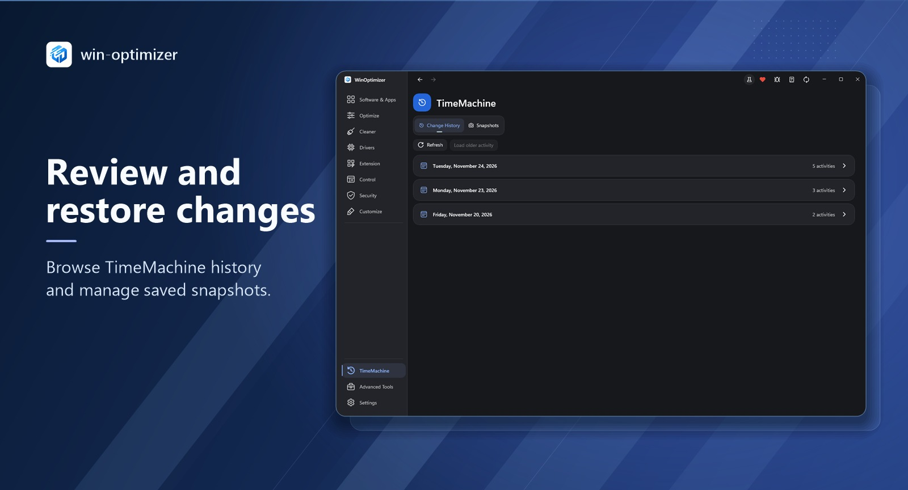

# Preview, back up, and restore settings

## Test mode

Select **Test mode** in the title bar to start a temporary draft of compatible
settings. The draft holds your edits during the session.

| Exit option | Result |
| --- | --- |
| **Export config** | Saves setting values and app selections in a `.win-optimizer` file. The app keeps the draft if the export fails or you cancel it. |
| **Apply changes** | Applies only edited settings through the configuration workflow. |
| **Discard** | Removes the draft. Closing the exit dialog also removes the draft. |

Test mode lets you change app preferences and run read-only Cleaner scans.
It blocks system actions such as power-plan deletion. Individual guides show
which tools can operate in Test mode.

## Import and export configurations

Open **Advanced Tools → Restore** to import or export a configuration. Test
mode permits exports.

An import can select apps for review or request removal. The removal list
excludes explicitly deselected **External Apps**. App selection alone leaves
File Explorer running. See [Windows app removal and the sign-in plan](SOFTWARE-APPS.md#uninstall-apps-and-features).

The import reports unverified app removals, failed setting changes, and failed
File Explorer restarts. A wallpaper-only request uses the current Windows
theme.

To apply **Windows Defaults**, confirm the operation in **Restore**. Windows
Defaults clears the policy values that win-optimizer manages.

The app saves an initial configuration backup at startup. If the backup fails
or times out, the app tries again at the next launch.

## Manage Windows restore points

Open **Advanced Tools → Restore** to list, create, or delete Windows restore
points. Test mode permits listing. Use Normal mode to create or delete a
restore point.

## TimeMachine

### Restore recorded changes

1. Open **TimeMachine** in the sidebar.
2. Select a day to see its recorded changes.
3. Select the available recovery rows.
4. Select **Restore selected**.

The timeline shows existing change records and supported registry edits,
preferences, scheduled tasks, driver removals, Cleaner operations, and
uninstall cleanup. Cancellation stops between resources. The results show
the changes that completed.

### Create and restore settings snapshots

1. Open **TimeMachine → Snapshots** before a system change.
2. Select **Create snapshot** at the top right. Snapshot cards appear newest first.
3. Select **Restore** on a snapshot card to compare it with current settings.
4. Select the rows to restore, then select **Restore selected** and confirm.

Select **Explore** on a snapshot card to browse its saved values in read-only
mode. To remove a saved snapshot, select **Delete** on its card and confirm the date.

The comparison shows changes to supported registry values, scheduled tasks,
and app preferences. The comparison includes changes from other programs.
TimeMachine checks the current state before each write and reports conflicts
individually. Some changes require a restart of win-optimizer, File Explorer,
or Windows.

### Driver package and cleanup recovery

Before **Drivers** removes an unused package, TimeMachine saves applicable
registry values and exports a verified copy of the package. Recovery stages
the original package in the driver store.

TimeMachine can restore supported Cleaner registry values. For other cleanup
backups, see [Cleaner recovery](CLEANER.md#read-results-and-restore-a-backup)
and [uninstall cleanup](SOFTWARE-APPS.md#review-leftovers-after-uninstallation).

The timeline shows disconnected device removals, file deletions, and older
records without recovery data for review only. File-deletion records keep
only path metadata.

### Set the retention period

Use **Settings → TimeMachine** to keep snapshots and recovery copies for 1 to
365 days. The default is 28 days. Reset TimeMachine settings or all settings
to use the default again.

The timeline keeps record metadata after the copies expire. TimeMachine
keeps unreadable recovery records and reports them in the app log. It
continues to apply the retention period to readable records.

## Logs and history

**Logs and history** groups saved sessions and change records by topic, with
the newest first. Use the filters below search to select a topic or activity
type.

Expand a topic to see its entries. Select **Technical details** to see errors
and record sources. Setting changes show the **Before** and **After** values.

Select **Load older activity** to read earlier records. To clear diagnostics,
select **Clear app logs** and confirm. The app keeps the change history.
