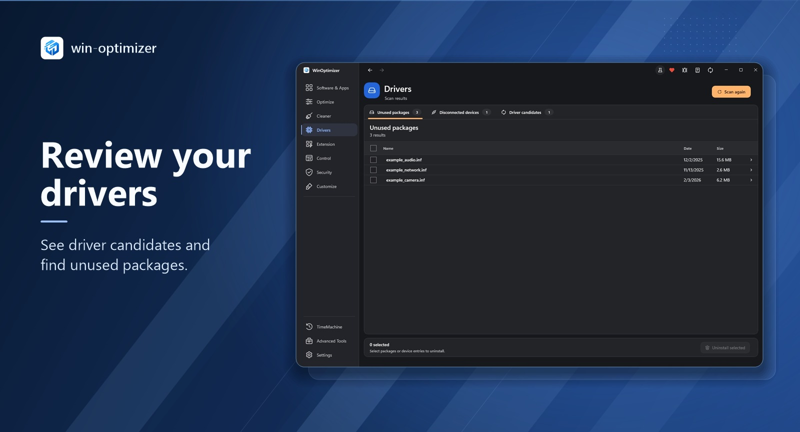

# Scan, download, and remove Windows drivers

## Check for driver updates

1. Open **Drivers**.
2. Select **Scan**. Follow device detection, source checks, and results preparation
   in the progress card. Select **View details** for live output or **Cancel scan**
   to stop.
3. Select **View scan details** when the coverage banner appears to see what
   could be checked. Open **Sources** for individual catalog results.
4. Open **Driver candidates** to compare installed and available versions,
   release dates, certification, and package sizes.

**Driver candidates** shows device matches, release channels, and
certification.

The app enables **Only show WHQL-tested driver updates** by default in
**Settings → Drivers**. Use **Filter settings** to edit scan preferences from
the results page, then select **Scan again** to apply them. Open **Filtered
candidates** to review offers that need more evidence or are incompatible.

Select **Verify package** to check a candidate. Select **Download selected**
to save packages under `%ProgramData%\win-optimizer\Downloads\Drivers`.
Select **Open official support** if the publisher manages the download.
Examine any publisher license before you accept it.

Select **Cancel** in the footer to stop verification or a download. Scans
and downloads read driver information without changing device bindings. See
[official driver sources, package verification, and downloads](../src/WinOptimizer.Infrastructure/Features/Drivers/README.md).

## Remove unused packages or disconnected devices

1. Select unused packages or open **Disconnected devices** and use **Search
   devices** to find entries by name or instance ID. The table checkbox selects
   the results currently shown. Individual selections stay selected across
   searches and categories.
2. Select **Uninstall selected**.
3. Confirm removal.
4. Examine the results for failures and restart requirements.

Removal requires administrator permissions. The app checks the current
inventory again and protects bound, changed, inbox, and boot-critical packages.
Select a disconnected device only if you intend to remove its registration.
Windows can detect the device again when you connect it. To remove its
driver package, select the package separately.

Cancellation stops the queue between Windows removal operations. The results
show the operations that completed. See
[driver package recovery](CONFIGURATION-RECOVERY.md#driver-package-and-cleanup-recovery).
