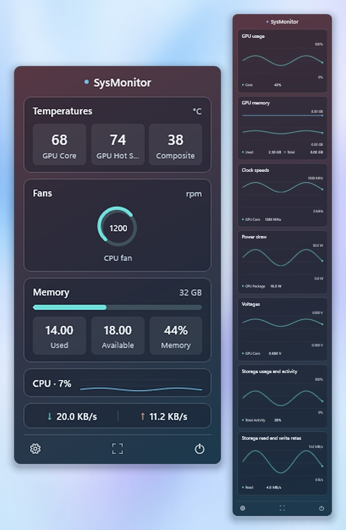
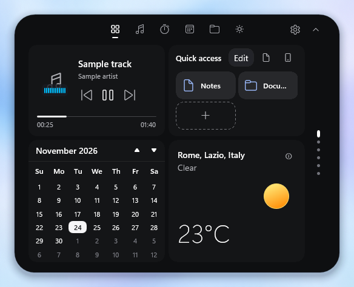

# Monitor hardware and customize desktop widgets

Open **Extension** to configure **SysMonitor**, **Notch**, or
[Preview with Space](PREVIEW.md).

## Start a widget with Windows

Open the widget's settings. Turn on the widget. Turn on **Start with Windows**
below the main switch. SysMonitor and Notch need a desktop administrator
account for this option. If you move a portable installation, open it again
to update the paths in its sign-in tasks.

Closing the main window exits win-optimizer. SysMonitor and Notch stay active in
the desktop widget companion. Select a widget’s settings icon to open its page
in win-optimizer. Turn off both widget switches to exit the companion.

## Monitor hardware with SysMonitor

SysMonitor shows CPU, memory, network, and available sensor values in a
movable desktop widget. Select the compact or expanded view. Use the
labeled icons to select readings for the expanded view.

Use settings to change the theme, refresh interval, and always-on-top
option. Set the scale from 50% to 200%. The default is 100%. The app saves
the settings automatically. Scale changes apply immediately.

Expanded GPU, clock, power, voltage, and storage cards show charts with
60 samples. Point to a chart legend to see the full sensor or device name.

Low-level sensors use LibreHardwareMonitor. These sensors can require
administrator permissions and PawnIO. Select the **PawnIO** link in Settings
to install it. Restart the app. Sensor support depends on the hardware,
firmware, and drivers.

## Configure Notch

Turn on **Notch** to show a compact widget at the top center of the desktop.
Open the Notch card or select the widget's settings icon. Select **Attached
notch** or **Floating island**. Select a connected display.

Notch uses the primary display if the selected display disconnects. It moves
back when that display connects again. The app saves changes and applies them
immediately. Media, Focus, Calendar, and Clock are on by default.

Select the widget to expand it. Select an icon or a dot to open a view.
Use the mouse wheel to move between views. Use the Calendar controls to
move between months. Long system panels can scroll.

The compact bar shows the clock by default. In Notch settings, select the
pin next to an enabled module to show or hide its reading in the compact bar.
Notch saves pins separately from the enabled modules. To change the order,
press and hold a compact reading. Drag it to the new position.

Select the collapse button or select another window to return to the
compact view. Turn off the Notch switch to hide it.

### Select Notch modules

| Module | Function |
| --- | --- |
| **Overview** | Turn on Overview in Notch settings. It starts with Media, Quick access, Calendar, and Weather tiles. Drag an enabled view icon from the upper bar onto a tile. If both views already have a tile, they exchange positions. Notch saves the layout. |
| **Media** | Shows playback and artwork from apps with a Windows media session. Use play, pause, or skip if the player supports the action. Drag the timeline or use its arrow keys if the player supports position changes. The visualizer uses the default audio output. |
| **Focus** | Use a 25-minute work timer, a 5- or 15-minute break, or a custom timer from 1 to 180 minutes. Pin the countdown to show it in the compact bar. When active, the countdown replaces the clock. |
| **Calendar** | Highlights the current day and lets you view other months. |
| **Sys info** | Shows CPU, memory, and supported GPU graphs. The traffic card shows current download and upload rates and the day's total Windows usage. Enabled readings continue in other views and in the compact bar. Open the settings arrow to select readings, including uptime. You can pin supported readings. |
| **Device batteries** | Has its own switch in Notch settings. Shows the PC and each connected Bluetooth LE device that reports a battery level. A bolt identifies a battery that Windows reports as charging. Pin the module to show these values in the compact bar. |
| **Audio visualizer** | Pin the visualizer to show microphone activity and recent levels from the default Windows playback device. |
| **Game FPS** | Pin the reading to show the successful DirectX 9 and DXGI presentation rate for the active full-screen or borderless game on the primary display. The reading needs Windows graphics tracing access and a visible desktop overlay. |

### Use Quick access

Quick access opens installed Windows apps and pinned files, folders, and
shortcuts. Select **+** to choose an app. Select **Add app**. Use the file
icon to pin a local item. To remove a pin, select **Edit**. Then select
**×** on the tile.

To send a file to a linked phone, select **Share to phone**. Select a file.
Then select **Phone Link** in Windows Share when it is available.

### Set the Weather location

Weather shows current conditions, the next four hours in the selected city's
local time, and seven days of high and low temperatures. It uses Astro's weather
icons.

1. Enter a city in **Weather location**.
2. Select a suggestion.

To clear the location, clear the text field. Select **Save**.

Location suggestions use [Photon](https://github.com/komoot/photon) and
[OpenStreetMap data](https://www.openstreetmap.org/copyright). The weather
view sends the selected coordinates to Open-Meteo. Select the information
icon to see the sources and terms. The optional free service is for personal,
non-commercial use. See the [Open-Meteo license](https://open-meteo.com/en/licence).

### Use Quick Settings

Enable **Quick Settings** to change supported display brightness, playback
volume, mute, Wi-Fi, and Bluetooth. Use **Night light** and **Do not disturb**
to change display warmth and notifications for the desktop account.

The panel shows the battery level and available Windows 11 power modes.
If direct wireless or power control is unavailable, the control can open
Windows Settings.

### Show status changes

Enable **Status changes** to show short alerts in the widget. Alerts cover
AC power, charging, the 20% battery threshold, Bluetooth, USB, audio devices,
volume, and supported display brightness.

Headphone alerts require jack detection from the audio driver. A connected
Bluetooth LE device can supply its battery level. Windows manages its own
system flyouts.
