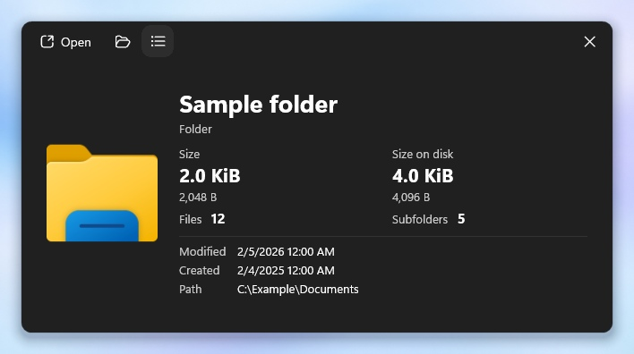
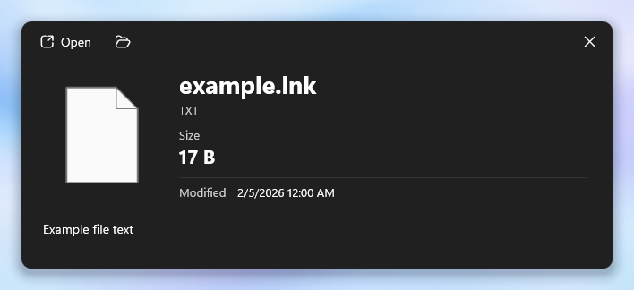

# Preview files and folders with Space

## Open a preview

1. Open **Extension → Preview**.
2. Turn on **Preview with Space**.
3. Select one file, folder, or shortcut on the desktop or in File Explorer.
4. Press **Space**.
5. Press **Esc** to close the preview.

The Space shortcut applies to the file list with keyboard focus. You can still
type spaces in search, address, and rename fields.

The summary shows the item's name, properties, and default Windows app icon.
If the app icon is unavailable, the summary uses Windows file-type artwork.
The popup stays above other windows while it is open. It expands to show
readable content within the display work area. Scroll to see more.

Use **Open** to open the selection with the default Windows action and close
the preview. Use **Show in File Explorer** to select the item in File Explorer.
The toolbar also provides **Folder contents** and PDF page controls when
applicable. Use the toolbar close button to dismiss the preview.

## Change Preview settings

**Preview with Space** controls the shortcut for the current session. Turn it
off to close the preview and release its media resources.

**Start with Windows** activates the shortcut in the background at the
desktop user's next sign-in. Regular and portable installations include
`win-optimizer-preview.exe` and `win-optimizer-preview.pri`.

Use **Background opacity** to set the opacity of the blurred background for
the Windows account. The scale goes from 0 to 10. The default is 8.

## Supported formats

| Item | Preview |
| --- | --- |
| Folder | File and subfolder counts, logical size, size on disk, and full path. Shows creation and modification dates and hidden or read-only attributes. **Folder contents** lists direct entries. |
| Plain text, Markdown, CSV, JSON, and similar files | Read-only excerpt. Preview supports UTF-8 and Unicode files with a byte-order mark. |
| DOCX, ODT, and PPTX | Document text. |
| PDF | Pages with **Previous page** and **Next page** controls for readable, unencrypted PDFs. |
| PNG, JPEG, GIF, BMP, WebP, TIFF, and ICO | Image and dimensions when the Windows codec supports the file. |
| Audio and video | Playback with Windows codecs. Audio shows the available title, artist, and album. |
| EXE and DLL | Architecture and available version data. |
| APK and ZIP | Archive entries and sizes. |
| Windows shortcuts, symbolic links, and junctions | Stored destination and a preview of the readable local target. **Show in File Explorer** selects the link. |
| Internet shortcuts (`.url` and `.website`) | Stored address as text. |
| Other files | Name, type, available size, and modification date. |

## Preview limits

Preview lists up to 400 direct entries in a folder or archive. It shows
up to 96 Ki characters of text.

Folder totals cover up to 100,000 entries, including subfolders. Preview
marks totals as partial if it reaches the limit or skips links, offline
items, or unreadable folders. Size on disk uses the Windows Shell
allocation property for each file.

Preview shows available properties for remote or offline items, broken
links, and unreadable files.
