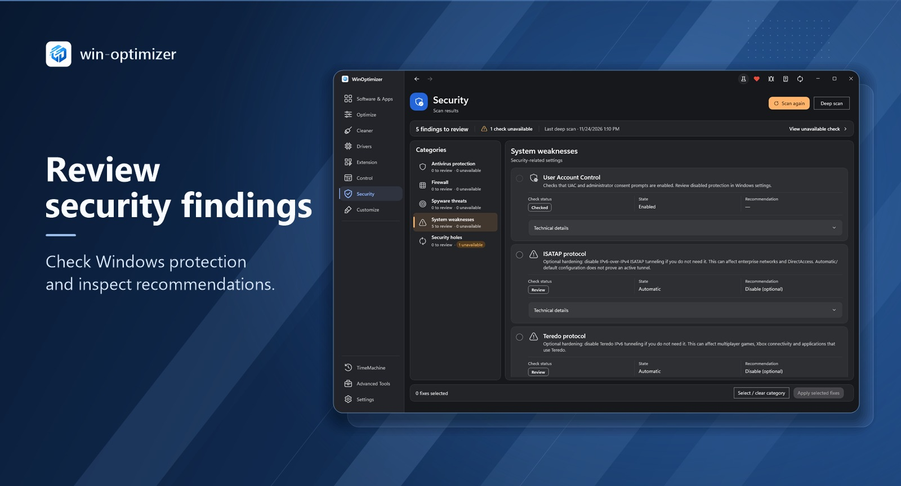

# Check Windows security settings

## Scan security settings

Open **Security**. Select **Scan**. The scan checks antivirus registrations,
firewall profiles, known active Defender threats, and User Account Control
(UAC). It also checks for pending security and critical updates in the local
Windows Update cache.

While the scan runs, the page shows its coverage. Select **View details** for
live output or **Cancel scan** to stop. **Deep scan options** lists the
additional checks.

If the cache has no results, check for updates online in Windows Update.
For a new malware scan, use Windows Security. To check a third-party antivirus
registration, use its provider's tools.

Select **Deep scan** to add checks for ISATAP, Teredo, Firefox home page
protection, language-list access, and app-launch tracking.

The results summary shows how many findings need review, how many checks were
unavailable, and when the scan finished. Select a category to see check status,
observed state, and recommendations. Expand **Technical details** to inspect
the evidence. **View unavailable check** opens an unavailable check and moves
to the next one if there are several.

## Apply security fixes

1. Select the supported findings.
2. Select **Apply selected fixes**.
3. Confirm the changes.
4. Examine the results.

Network changes can affect managed networks and games. Firefox protection
locks the policy home page and uses `about:home` if there is no policy URL.
Restart Firefox after the change. Examine custom Firefox policies and portable
installations manually.

The app checks each finding again before it writes a fix. Then it reads the
setting to verify the result. The results identify changed, unavailable,
managed, or tamper-protected settings. Cancellation keeps completed changes.
Scan again before you retry a fix.

Test mode and configuration review permit scans. Use Normal mode to apply
fixes. Examine UAC, threats, and updates in Windows settings or in your
antivirus.
