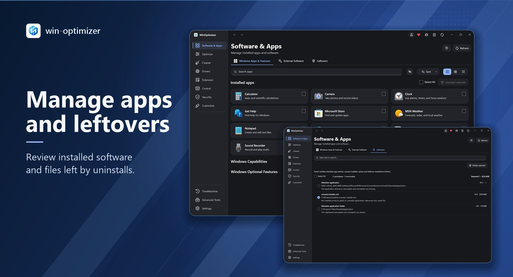

# Remove Windows apps and desktop programs

## Find installed apps

Open **Software & Apps**. **Windows Apps & Features** lists packaged Windows
apps, capabilities, and optional features. Type in the search field to filter the list.
**External Software** lists supported programs and desktop programs that
Windows registers for the device or the current account. Programs outside the
catalog appear under **Other Utilities**.

Table, card, and compact views share the saved sort order. Sort by group, name,
installation date, size, or last usage. Date and size sorts show the newest or
largest entries first. Unknown values appear last. Cards and compact views
retain groups. Use the sort icon in narrow windows or select a column header
to sort the table.

Windows can report an update date as the installation date. Size is an estimate
or the size of the packaged files. Last usage comes from the signed-in account's
available Windows Shell launch history. The app shows **—** for unavailable
values.

Select the crossed-out eye beside the search field to show hidden or inactive
apps. Select the open eye to hide them again. This filter requires administrator
permissions and adds known AppX packages that Windows keeps on the device without
a registration for the current account. An orange indicator identifies each
inactive entry.

Select **Refresh** to discover new programs and update desktop icon references.
The list uses artwork from installed Windows packages or registered desktop
icons. If the app cannot read the artwork, it shows a category icon.

## Uninstall apps and features

Select the entries to remove. In **Installed apps**, **Select All** applies to
the app packages shown by the current filters. Select **Uninstall selected**,
confirm the operation, and monitor progress in the footer. Select the footer
progress entry to see the task output.

Desktop programs use their registered uninstaller when the app can identify
one exact match. win-optimizer minimizes and waits for the uninstaller to exit.
If there is no exact match, a prompt offers automatic removal from the available
package manager or detected installation files. Cancel the prompt to keep the
program.

Windows servicing reports each selected Windows app, capability, or optional
feature separately. It verifies capability and feature status and shows when
Windows needs a restart. Select **Save removal scripts** to add eligible
selections to the sign-in plan. One-time removal keeps the existing plan.
To defer work to the next sign-in, enable the applicable scheduled task.
Autounattend uses the same servicing script for package and feature selections.

Cancellation keeps completed results. A desktop uninstaller, AppX removal
phase, or servicing operation can finish before the queue stops. The app
refreshes the inventory after the operation, including after a partial failure
or cancellation. The results confirm each removal only after verification.

AppX inventory, desktop app removal, and portable app paths use the signed-in
account, also when you run win-optimizer with another administrator's credentials.

## Review leftovers after uninstallation

1. Select **Scan** on the review page.
2. Select the files and folders to remove.
3. Select **Delete selected**.
4. Confirm the deletion.
5. Repeat the selection and deletion steps for the registry entries.

Each step includes **Select all**, **Deselect all**, and individual and group
selections. The app preserves your selections when you move between steps.
Each deletion uses only the selections for the current step. The review also
shows steps with no results.

The scan protects active, shared, restart-deferred, and unverifiable resources.
The results show any limits on scan coverage. Select **Scan again** to update
the results. Cleanup requires a verified backup. Restore the backup from the
review page or from **Uninstall cleanup backups**.

## Find leftovers from earlier installations

Open the **Leftovers** tab to scan for obsolete app registrations, unused
installer caches, and old installation folders. The scan includes shared app
locations and registered Windows accounts. Examine the path and eligibility
reason for each item before you select it. The selection summary counts items
that the current search hides.

Select **Delete selected** to start cleanup. The same backup requirement
applies. Select **Refresh** to scan again. See
[scan scope and eligibility rules](../src/WinOptimizer.Infrastructure/Features/SoftwareApps/Leftover/README.md).

To select or remove apps from a configuration file, see
[configuration import](CONFIGURATION-RECOVERY.md#import-and-export-configurations).
