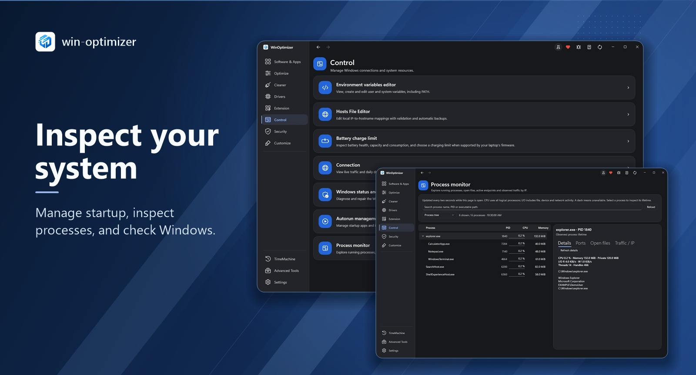

# Manage Windows startup, processes, and system health

Open **Control** to use the system tools. Test mode and configuration review
block changes to environment variables, the hosts file, and battery firmware.
These changes require the applicable Windows or firmware permissions.

## Edit environment variables

Open **Environment variables editor**. Use the list or text view to edit user
or system variables. You can change the order of the entries in `PATH`.
Select **Save** to apply the changes.

The editor saves values without expansion. User edits apply to the signed-in
account, also when you run the app with another administrator's credentials.
Restart affected programs to use the new values.

Before a refresh or scope change, the editor asks what to do with unsaved
edits. If the editor cannot read the new scope, it keeps the current draft.

## Edit the hosts file

Open **Hosts File Editor**. Use the list or text mode to edit IPv4 or IPv6
mappings, aliases, comments, and switches. Select **Save changes** to apply
the edits.

The editor validates the draft, checks for external changes, and verifies a
backup. It preserves the file encoding and permissions. Use **Undo last save**
to restore the previous version through the same checks.

## Set a battery charge limit

Open **Battery charge limit** and choose **Stop charging at**. The list includes
60%, 70%, and 90% when supported. On compatible Dell firmware, use **Resume charging**
to pick a fixed battery level, restart 10 or 20 percentage points below the
stop limit, or use **Soonest supported** for the highest restart threshold the
firmware accepts. The available choices depend on the selected stop limit. For a 100%
stop limit, choose **100% (Standard charging)** to use the firmware's normal charging
behavior when that mode is available.

Select **Apply limit** to write the settings. The page displays the confirmed
firmware values and available health, capacity, and power measurements. Open the
page again after reconnecting AC power to check whether charging has stopped. If
the battery is still charging above the reported limit, the page shows a warning
and links to the manufacturer's instructions. Acer Battery Health Mode offers
fixed 80% and 100% settings. **Resume charging** displays **Firmware-controlled**
when the device manages the restart threshold.

Support depends on the device, firmware, and drivers. See
[battery support and firmware requirements](../src/WinOptimizer.Infrastructure/Features/Utilities/README.md).

## Check network connections

Open **Connection** to see 30 days of usage and a live 15-minute traffic
window while the page is open.

Open **Saved Wi-Fi passwords** to see profiles, adapter and security data, and
readable passwords. Windows permissions control access. The page identifies
open networks, enterprise authentication, and unavailable keys separately.
The app clears credentials from memory when you leave the page. Use the
signed-in account to open the inventory.

## Manage startup entries

Open **Autorun management** to see user, shared, and system startup entries.
Select an entry and use its state switch to confirm a supported change. See
[startup sources, permissions, and Microsoft Autorunsc](../src/WinOptimizer.Infrastructure/Features/Management/AUTORUNS.md).

To open the app at sign-in, see
[Start win-optimizer at sign-in](GETTING-STARTED.md#start-win-optimizer-at-sign-in).

## Monitor processes

Use **Process monitor** to see the process tree, CPU, memory, I/O, process
details, and TCP or UDP ports.

See [process measurements and permissions](../src/WinOptimizer.Infrastructure/Features/Management/PROCESS-MONITOR.md)
for sort options, open-file queries, and network traffic.

## Diagnose and repair Windows

Open **Windows status and restore** to run a quick health check, a full
diagnosis, or a DISM and SFC repair. Component cleanup requires separate
confirmation. See [Windows servicing operations](../src/WinOptimizer.Infrastructure/Features/Management/README.md)
for repair sources, restart restrictions, ResetBase, and cancellation.
