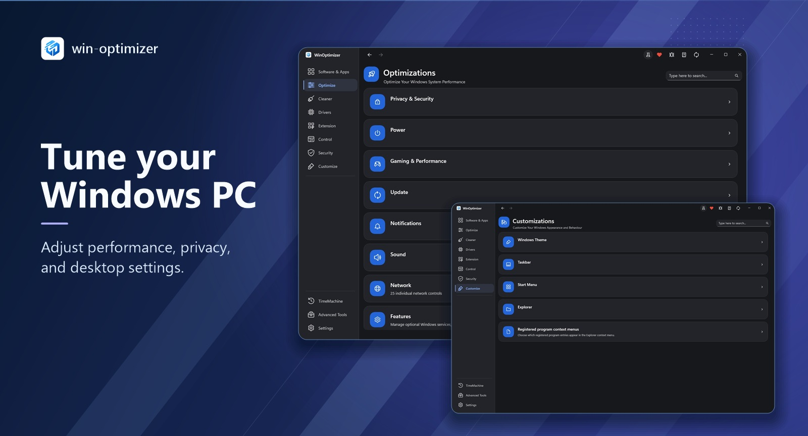

# Change Windows privacy, performance, and desktop settings

## Optimize and Customize

Use **Optimize** and **Customize** to find Windows settings for privacy, gaming,
Windows Update, power, sound, notifications, and the desktop. Each control
shows the current setting and available options.

Use **Privacy & Security**, **Notifications**, and **Start Menu** to find
individual controls for advertising, suggestions, and promotional content.
Configuration review shows the queued changes that match your search.

**Test mode** and configuration review block changes in the context-menu,
network, and optional-feature tools. See [Test mode](CONFIGURATION-RECOVERY.md#test-mode).

### File Explorer context menu

Use the group switch to enable or disable a program's supported context-menu
entries. Expand a group to change one entry. Use the icons, counts, search,
and registry paths to identify entries.

Each change applies immediately. Use the same switch to reverse it. Windows
can require administrator permissions for device-wide entries. Group changes
report partial failures.

The tool supports registry commands, COM handlers, and file-type registrations.
Some packaged Windows 11 extensions can be absent from the list.

### Internet

Open **Internet** in the sidebar and select **Start test**. The test estimates
download, upload, and HTTPS latency to Cloudflare using up to about 70 MB of
traffic. Run it again after making a change to compare successful measurements.

In the **Network** card, choose a configuration under **DNS servers** and select
**Apply DNS to all connections**. Choose **Automatic (DHCP)** to restore the
network-provided DNS settings. **Windows VPN profiles** lists the
signed-in user's and all-users profiles. Select **Manage VPN in Windows** to
open Windows Settings.

Use **Reload** to reread VPN profiles and current Windows network settings.
In **Network settings → TCP behavior**, use **TCP receive-window auto-tuning** to
choose a level such as **Normal**. In **Network settings → Network offloading**,
use **Receive-side scaling (RSS)** to turn RSS on or off. Confirm each change.

Limit Delivery Optimization bandwidth if Windows background downloads compete
with other traffic. Select **Clear override** to remove the local limit or enter
**0** to explicitly request automatic adjustment.

Under **Network settings**, search DNS, VPN, and the individual tuning
controls by group, name, description, or Windows parameter. Each tuning row
shows the first value the app successfully read on this PC next to its
suggested value. The app keeps the original across reloads and restarts.
The editor shows the live Windows value. Select a tuning control and confirm
the change. The tool reports read errors and checks the value after a write.
See the [network controls guide](../src/WinOptimizer.Infrastructure/Features/Optimize/README.md)
for the available settings, their limits, and restart requirements.

### Optional Windows features

Confirm a switch to restrict selected services, diagnostic data, Cortana,
Copilot, or advertising. Turn a switch off to restore the applicable policies
and documented service defaults. Windows uses those defaults even if you
previously set custom service options.

The services switch applies to installed Retail Demo, Offline Maps, and Fax
services. Restart Windows after you change it. Windows 10 also has a Timeline
activity publishing switch. Windows Home and Pro can continue to send required
diagnostic data.

The Copilot switch applies Windows and Edge policies. It also removes the
signed-in account's Microsoft Copilot app and its local data. The switch shows
policy status. Turn it off to restore the policies. Use Microsoft Store to
install the app again. Edge policy coverage depends on its version and
profile. You can still use Copilot on the web. For individual policy and
service controls, see **Privacy & Security** and **Gaming and Performance**.

Windows Update notifications are on in the recommended and Windows-default
configurations. Turn them off to suppress standard notifications, including
restart warnings.

Configuration presets and exports exclude the optional-feature tools.

To examine security settings and apply supported fixes, see the
[Security guide](SECURITY.md).
